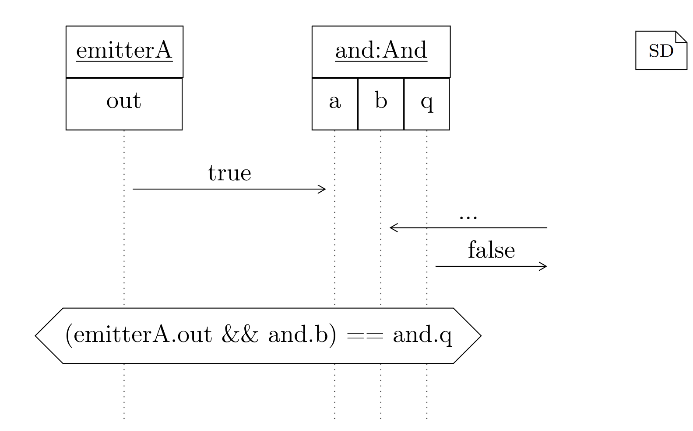

<!-- (c) https://github.com/MontiCore/monticore -->
# Sequence Diagrams for Testing

Sequence diagrams are well suited for the specification and testing of behavior.
Here we will only focus on the testing part. To enable this feature, use the [SD2Arc](../../Usage/Gradle/SD2Arc.md) Tool.

MontiArc provides an integration for sequence diagrams. They look similar to
UML sequence diagrams, only with some minor modifications.

In general, sequence diagrams are exemplary and describe one possible interaction of a system.
For a detailed definition of sequence diagrams, read [Modeling with UML](https://link.springer.com/book/10.1007/978-3-319-33933-7).

<center markdown>
{ width="600"}
</center>

For every sequence diagram, SD2Arc generates a MontiArc test component. It contains the
components of the diagram and an observer that stimulates them, observes their interactions, and
fails the test if the observed run does not match the diagram.

## Test
Sequence diagrams have a package and a name like any other model in MontiArc.
A sequence diagram starts with the listing of components included in the sequence.
This is a list of names and optionally a type. For tests that stand on their own
the type is always required.
Next comes a list of interactions that have a source and target port and a message.
Interactions between two components imply a connector between the respective ports.

Messages from the test environment omit the source and are marked with the `trigger` keyword.
They are sent by the observer to stimulate the components. Interactions without a source and
without `trigger` are observations of a connector and therefore require the target port to be
connected; otherwise the tool reports an error.
Messages to the test environment omit the target.

A test is considered successful if all interactions with the specified values
were observed in the specified order, and no assertions have failed.

Given the following example. The test inputs `true` and `false` to the respective
ports and asserts that an outgoing message `false` is observed.
All of this should occur within one tick as specified by `<<ticks=1>>`.

```sequencediagram
package a.b;

<<ticks=1>>
complete sequencediagram AndScenario01Test {
  and:And;

  -> and.a : trigger true;
  -> and.b : trigger false;
  and.q -> : false;
}
```

If a message value is not of interest or is unknown `...` can be used.
Then only that the interaction occurs is asserted, but not its value.

The last message of a port can always be referenced in expressions.
Variables can be created at any point using the `let` keyword.
Like `assert` statements, `let` statements are executed directly after
the previous interaction has been observed.

```sequencediagram
package a.b;

complete sequencediagram AndScenario02Test {
  and:And;

  -> and.a : trigger true;
  -> and.b : trigger true;
  and.q -> : ...;                  // Ignored
  let boolean qFirst = and.q;      // qFirst = true

  -> and.a : trigger qFirst;       // true
  -> and.b : trigger and.q;        // true
  and.q -> : ...;                  // Ignored
  assert and.q;                    // assert last and.q == true
}
```

### Ticks

`Tick;` denotes the passing of time, i.e., the end of a time slice.
Interactions stated before a tick have to occur in that time slice, interactions after it in a later one.
Hence, a component that reacts without delay answers before the tick, while a delayed component
answers after it.

For components with synchronous ports, a tick block `Tick { ... }` groups the interactions that occur
within the same tick. Triggers of a tick block are sent at the start of that tick.
As a synchronous stream carries a message in every tick, the test keeps sending the last triggered
value of a synchronous port in every following tick until a new trigger replaces it.

```sequencediagram
package a.b;

import montiarc.types.OnOff;

complete sequencediagram InverterChainTest {
  inv1:Inverter;
  inv2:Inverter;

  Tick {
    -> inv1.i : trigger OnOff.ON;
    inv1.o -> inv2.i : OnOff.OFF;
    inv2.o -> : OnOff.ON;
  }

  Tick {                            // inv1.i still receives ON
    inv1.o -> inv2.i : OnOff.OFF;
    inv2.o -> : OnOff.ON;
  }

  Tick {
    -> inv1.i : trigger OnOff.OFF;
    inv1.o -> inv2.i : OnOff.ON;
    inv2.o -> : OnOff.OFF;
  }
}
```

### Test configuration

The stereotype of a sequence diagram configures the generated test, e.g., `<<ticks=5>>`.

| Stereotype            | Default                   | Description                                                                                                                                              |
|-----------------------|---------------------------|----------------------------------------------------------------------------------------------------------------------------------------------------------|
| `ticks`               | `9999` (see `defaultTicks`) | The maximum number of ticks the test is simulated. If the diagram has not been matched completely in the last tick, the test fails.                     |
| `exception`           | *(none)*                  | The exception the test is expected to throw, e.g., `exception=java.lang.AssertionError.class` for a diagram that the system must **not** fulfill. |
| `simulatedTickLength` | `0`                       | The simulated time of a tick in nanoseconds.                                                                                                             |
| `montiarc`            | *(none)*                  | The path to a decomposed component to [embed](#embedded) the diagram in, given as string.                                                               |

A diagram that a system must violate can therefore be expressed as a test, too:

```sequencediagram
package a.b;

<<ticks=5, exception=java.lang.AssertionError.class>>
sequencediagram AndNeverOutputsTrue {
  and:And;

  -> and.a : trigger true;
  -> and.b : trigger false;
  and.q -> : true;
}
```

## Embedded

Another possible way to use sequence diagrams is to specify an existing architecture.
For that, an existing decomposed MontiArc model has to be specified for which an
interaction between the subcomponents can be modeled.
The types of the components and the connectors are taken from the embedding component.
Subcomponents adjacent to the stated ones are added to the test as free components that are not part
of the diagram. Their interactions with stated `complete` or `visible` components are still checked.
Connectors from incoming ports of the embedding component are removed,
so the test has to stimulate each subcomponent port that would be fed by it.

```sequencediagram
<<montiarc="path/to/And.arc">>
sequencediagram AndSD1 {
  visible notA;
  notB;
  nor:Nor;

  // And forwards a to notA.a and notA.b, and b to notB.a and notB.b
  -> notA.a : trigger true;
  -> notA.b : trigger true;
  -> notB.a : trigger true;
  -> notB.b : trigger true;
  notA.q -> nor.a : false;
  nor.q -> : ...;

  assert (notA.a && notB.b) == nor.q;
}
```

## Semantics

We have previously said that C&C sequence diagrams are exemplary. This means the modeled
interaction can occur once, multiple times at any frequency, concurrently, or never.
Furthermore, a sequence diagram can be an abstraction of the real execution by omitting
components and interactions. How a sequence diagram models executions can be controlled with
matching stereotypes, which can alter the semantics. We define three different
interpretations for sequence diagrams, known from UML sequence diagrams defined by [Modeling with UML](https://link.springer.com/book/10.1007/978-3-319-33933-7).
They can be applied to the whole model and to individual components,
where applying them to the whole model is equal to applying them to each component
individually. In the graphical notation, the name can be prefixed with a stereotype to
indicate that it should be interpreted correspondingly. In the textual notation, keywords
are used for this purpose.

Independent of the interpretation, the stated interactions have to occur in the stated order.
The restrictions of `complete` and `visible` only hold between the first and the last stated
interaction; before and after, any interaction may occur.
A trigger is an interaction, too. If a diagram starts with a trigger, the restrictions hold right after it.

#### Free
This is the default interpretation and allows any interaction or component to be
omitted. The stereotype is `«match:free»` and the keyword is `free` or `...`.

#### Complete

The opposite of free. No interaction displayed in the timeframe can be omitted,
and all interactions that occur must be included in the model. This includes interactions
with the test environment, i.e., outgoing messages that are not received by a stated component.
Interactions outside the timeframe, that is, interactions before and after the first and last
interaction on a timeline, can still occur and be omitted from the model. The stereotype is
`«match:complete»` and the keyword is `complete`.

#### Visible

Similar to complete, but interactions with components not included in the diagram, including the
test environment, can be omitted. Interactions between components included in the model, i.e.,
visible components, have to be complete. The stereotype is `«match:visible»` and the keyword
is `visible`.

#### Synchronous ports

A synchronous port carries a message in every tick. Hence, every tick block has to state each
synchronous outgoing port whose interactions may not be omitted, i.e., ports of `complete`
components and ports between `visible` components. Otherwise, the tool reports an error, as the
diagram could never be fulfilled. This includes empty tick blocks (`Tick;`).
For the same reason, once the first interaction has been observed, every tick has to match the next
tick block if the diagram contains such a port; deviating ticks cannot be omitted.

!!! note "Limitations"
    The interpretation `«match:initial»` from Modeling with UML is not supported.
